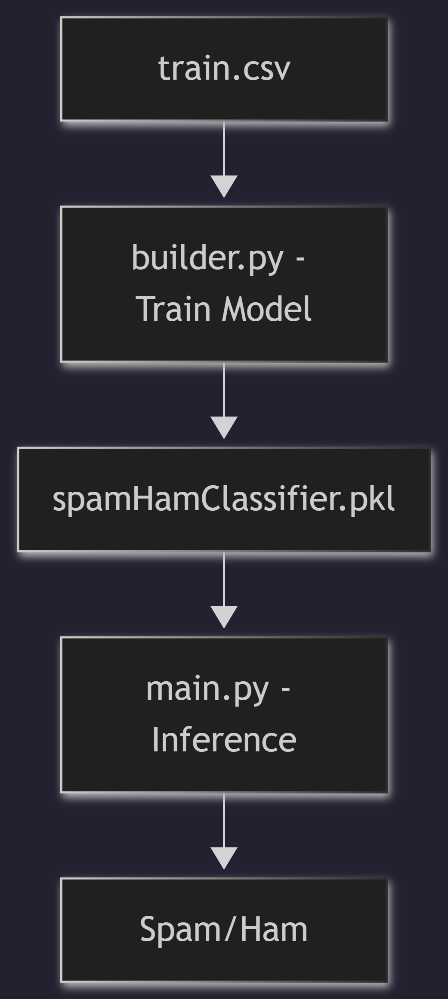

# AI - Spam Detection Model

Machine learning components for spam/ham classification.

## Workflow

## Contents
- `train.csv`: Training dataset (balanced).
- `builder.py`: Script to train and save the model.
- `main.py`: Inference script to use the saved model.
- `spamHamClassifier.pkl`: Serialized machine learning model.
- `requirements.txt`: Python dependencies.

## Setup
1. `pip install -r requirements.txt`
2. Run `builder.py` to retrain if necessary.
3. Use `main.py` for testing predictions.

---
*Dataset Source: [Kaggle](https://www.kaggle.com/datasets/zubairmustafa/spam-and-ham-classification-balanced-dataset)*
