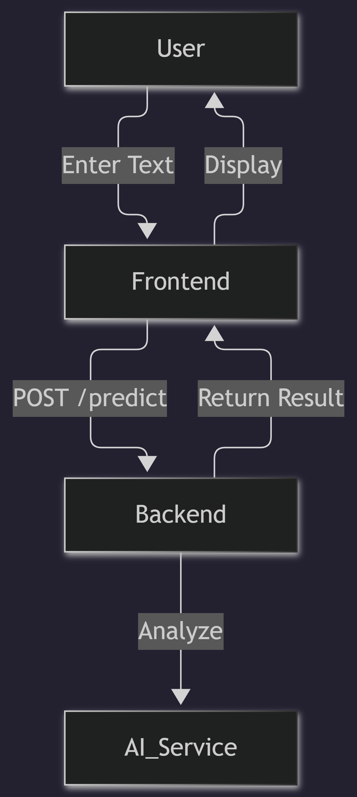

# Email Spam Detector

A full-stack application to detect spam in email text.

## Architecture Overview

## Project Structure
- [Backend](./backend/README.md): Node.js/Express server handling request validation, rate limiting, and spam prediction logic.
- [Frontend](./frontend/README.md): React application styled with Tailwind CSS for user interaction.
