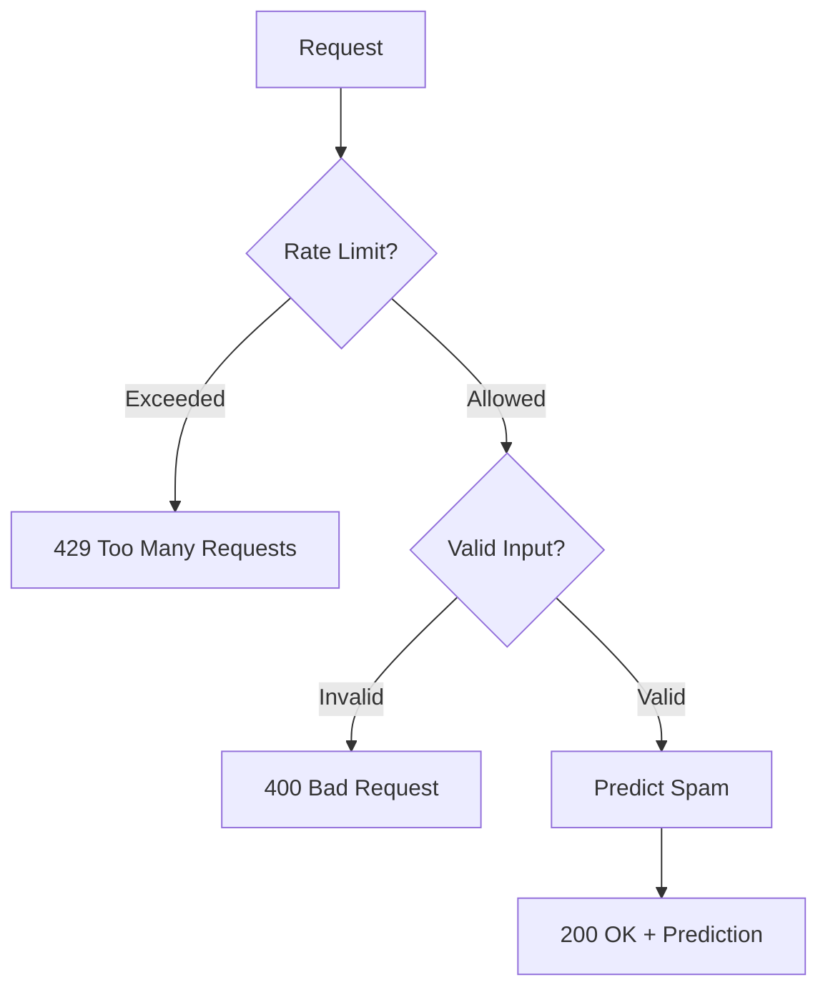

# Backend

Node.js/Express server for spam prediction.

## Request Flow

## Features
- Rate Limiting (`express-rate-limit`)
- Request Validation (`express-validator`)

## Setup
1. `cd backend`
2. `npm install`
3. `npm run dev`
