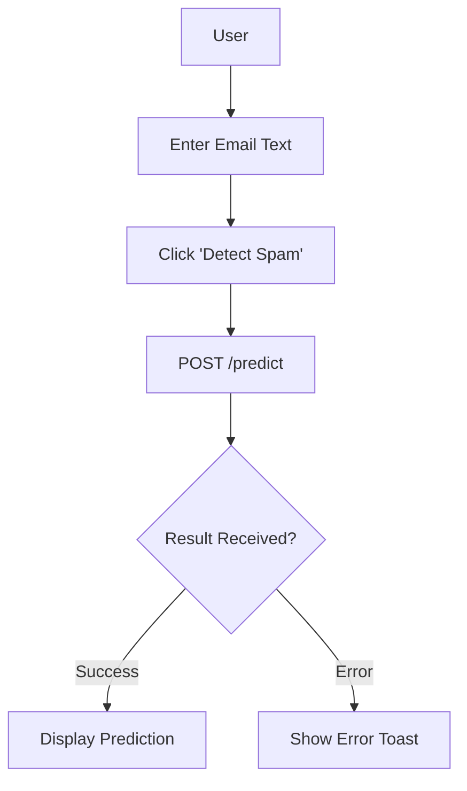

# Frontend

React application for spam detection UI.

## Workflow

## Features
- Tailwind CSS styling
- Responsive design
- Toast notifications

## Setup
1. `cd frontend`
2. `npm install`
3. `npm run dev`
